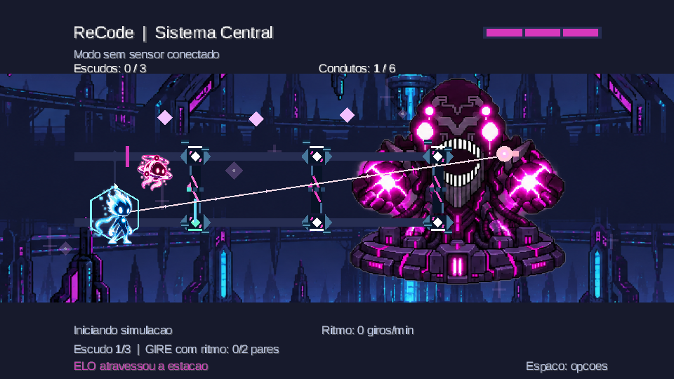
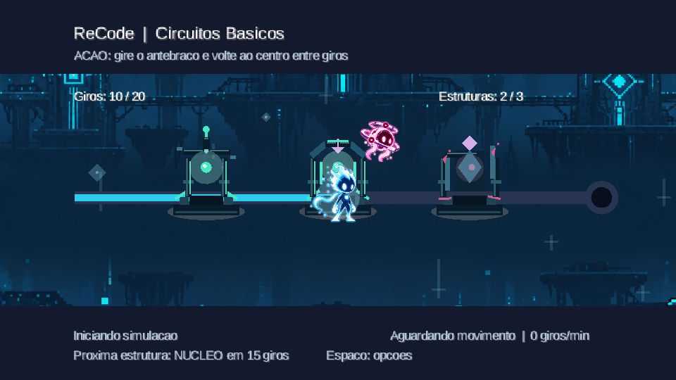
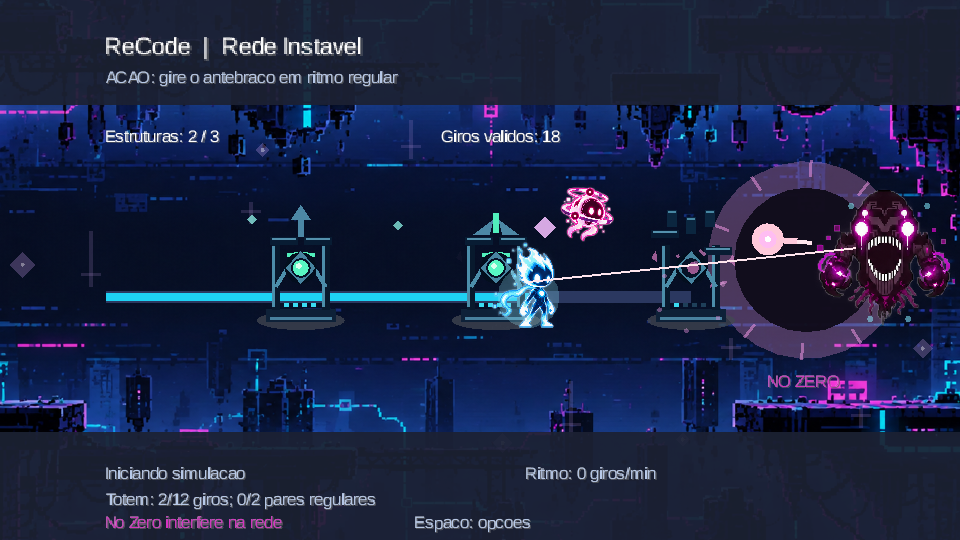
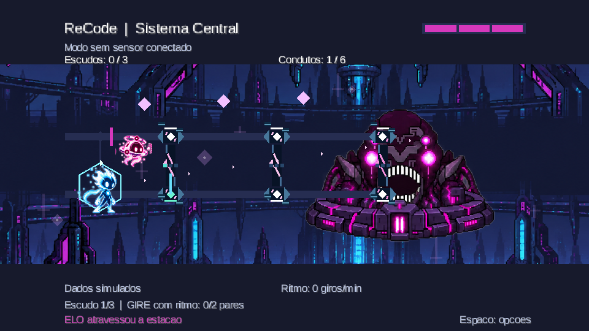

<div align="center">

<h1>ReCode</h1>

<p><strong>Um jogo digital para apoiar a prática de giros controlados do antebraço</strong></p>

<p>ELO percorre uma rede de circuitos corrompida pelo Nó Zero. Cada movimento ajuda a reparar estruturas, estabilizar conexões e restaurar o sistema central.</p>

<p>
  
  
  
  
</p>
<p>
  
  
  
  
</p>

<p>
  <a href="#como-jogar"></a>
  <a href="prototipo_pedal/firmware/recode_pedal/recode_pedal.ino"></a>
  <a href="docs/Apresentacao_Projeto_ReCode_Professor_V2.pptx"></a>
  <a href="ENTREGA.md"></a>
</p>



<sub>Captura da fase 3 em modo de simulação. As imagens abaixo mostram a versão atual do jogo.</sub>

</div>

O controle físico usa um **MPU6050 no antebraço**, uma **ESP32 por USB** e um jogo de computador desenvolvido em **Java com libGDX**. Há também um modo teclado para apresentar e testar a campanha sem o dispositivo.

## 🎮 O projeto em poucas linhas

| | |
| --- | --- |
| **Finalidade física** | Praticar a rotação do antebraço com retorno à posição central e atenção à regularidade dos movimentos. |
| **Interação** | O sensor mede a inclinação; a ESP32 transmite os gestos por USB serial; o jogo transforma cada giro válido em progresso. |
| **Campanha** | Três fases integradas, com reparos, ataques, três corações, escudo temporário, trilhas e efeitos sonoros. |
| **Acesso** | Executáveis para Windows no pacote de entrega e modo teclado para demonstração. O código fonte está neste repositório. |

As metas de giros e os ângulos são **regras do jogo**, não uma prescrição terapêutica. O ReCode ainda não foi avaliado clinicamente com pacientes.

## 🕹️ As três fases

### 1. Circuitos Básicos

ELO aprende a percorrer a rede: os giros restauram três estruturas, ativam trilhas e permitem recolher fragmentos de energia. A fase termina após 20 giros válidos.

<p align="center"></p>

### 2. Rede Instável

O desafio passa a considerar a **regularidade entre giros**. O jogador estabiliza três estruturas enquanto o Nó Zero interfere na rede e dispara contra ELO.

<p align="center"></p>

### 3. Sistema Central

O confronto final combina precisão, ritmo e estabilidade. O Nó Zero aparece ao fundo como chefe da arena. ELO recupera os três corações ao entrar nesta fase e **muda de rota automaticamente após três giros individuais**; o jogador pode manter o braço apoiado, sem precisar levantá-lo ou abaixá-lo.

<p align="center"></p>

Nas fases 2 e 3, uma sequência de giros regulares ativa o escudo do mascote por **15 segundos**. O menu oferece uma tela **Como jogar**, pausa livre e opção de suavizar os efeitos de fundo. A campanha preserva os indicadores de desempenho entre fases; ao perder os três corações, a tentativa recomeça.

<a id="como-jogar"></a>

## 🚀 Como jogar

### Pelo pacote de entrega para Windows

1. Extraia o ZIP completo em uma pasta.
2. Abra `Executaveis/ReCode`.
3. Inicie `ReCode-Teclado.exe` ou `ReCode-ESP32.exe`.

Mantenha as pastas `app` e `runtime` junto dos executáveis. O pacote de entrega é distribuído separadamente do repositório; veja as instruções completas em [ENTREGA.md](ENTREGA.md).

No **modo teclado**, use as setas para registrar giros. No menu, navegue com as setas e confirme com `Enter`. Durante o jogo, `Espaço`, `P` ou `Esc` abre a pausa, com opção de voltar ao menu.

No **modo ESP32**, conecte a placa por USB e feche o Monitor Serial da Arduino IDE antes de abrir o jogo. Apoie o antebraço na posição central e mantenha-o estável por cerca de dois segundos para calibrar. Depois, gire a palma de maneira confortável e **volte ao centro entre giros**. Se o sinal falhar, a campanha pausa e aguarda a reconexão sem descartar o progresso.

### Pelo código fonte

O projeto desktop usa **JDK 17**, **Gradle**, **libGDX 1.14.2** e **jSerialComm 2.11.4**. Na pasta `prototipo_pedal/desktop`:

```powershell
gradle run -Pkeyboard=true       # jogar pelo teclado
gradle run -Pport=COM3           # jogar com a ESP32; ajuste a porta
gradle verifyCampaign           # verificar as regras da campanha
```

Há mais opções de execução e diagnóstico em [prototipo_pedal/README.md](prototipo_pedal/README.md).

## 🔌 Controle com ESP32 e MPU6050

O firmware está em [recode_pedal.ino](prototipo_pedal/firmware/recode_pedal/recode_pedal.ino) e é gravado pela Arduino IDE na ESP32 DevKit. A ligação I²C usada no projeto é:

| MPU6050 | ESP32 |
| --- | --- |
| VCC | 3V3 |
| GND | GND |
| SDA | GPIO 21 |
| SCL | GPIO 22 |

O módulo é fixado com o **eixo X ao longo do antebraço**. O firmware calibra a posição inicial, lê o acelerômetro a cada 20 ms e envia quadros JSON pela USB serial a 115200 baud. O jogo valida o estado e a sequência dos quadros antes de contar novos movimentos. A montagem, o posicionamento e os limites de ângulo estão explicados no [guia do controle](prototipo_pedal/README.md#dispositivo).

```text
MPU6050 → ESP32 → USB serial/JSON → jogo libGDX → ELO e estruturas
```

## 🗂️ Organização do projeto

| Caminho | Conteúdo |
| --- | --- |
| [`prototipo_pedal/desktop/`](prototipo_pedal/desktop/) | Jogo libGDX, telas, regras, sprites, cenários, áudio e verificação da campanha. |
| [`prototipo_pedal/firmware/`](prototipo_pedal/firmware/) | Firmware do MPU6050 para a ESP32. |
| [`docs/`](docs/) | GDD, relatórios, short paper e apresentação. |
| [`planning/`](planning/) | Planejamento e registros do Kanban. |

Entre as classes principais, `CampaignGame` coordena menu e transições, `CampaignProgress` mantém vidas e desempenho, `PhaseOneProgress`/`PhaseTwoProgress`/`PhaseThreeProgress` aplicam as regras das fases, e `SerialPedalSource`, `PedalFrame` e `PedalCounter` recebem e validam os dados do sensor.

## 📄 Documentação e entrega

- [Apresentação para o professor, com foco no código e nas fórmulas](docs/Apresentacao_Projeto_ReCode_Professor_V2.pptx)
- [Short paper com registros das fases e do Kanban](docs/shortpaper_V2.docx)
- [Relatório final](docs/Relatorio_Final_ReCode.docx)
- [Game Design Document](docs/ReCode_GDD.docx)
- [Guia de compras e montagem IoT](docs/ReCode_Guia_de_Compras_e_Montagem_IoT.docx)
- [Instruções do pacote final](ENTREGA.md)
- [Kanban no GitHub Projects](https://github.com/users/Pinkpie186/projects/8) — quadro privado; as [Issues](https://github.com/Pinkpie186/recode-iot-libgdx/issues) registram parte do planejamento publicamente.

## ✅ Estado da integração

Na validação de **9 de novembro de 2026**, a ESP32 foi identificada na COM3. Uma leitura recebeu 201 quadros consecutivos em estado `ok` durante 20 segundos; o leitor serial do jogo recebeu 149 quadros em 15 segundos e aceitou quatro giros reais. A campanha passou na verificação automatizada e os dois executáveis Windows abriram no computador usado na entrega.

Esses resultados comprovam a comunicação e a contagem observadas nesse teste. **Não medem ganho funcional ou eficácia clínica.**
